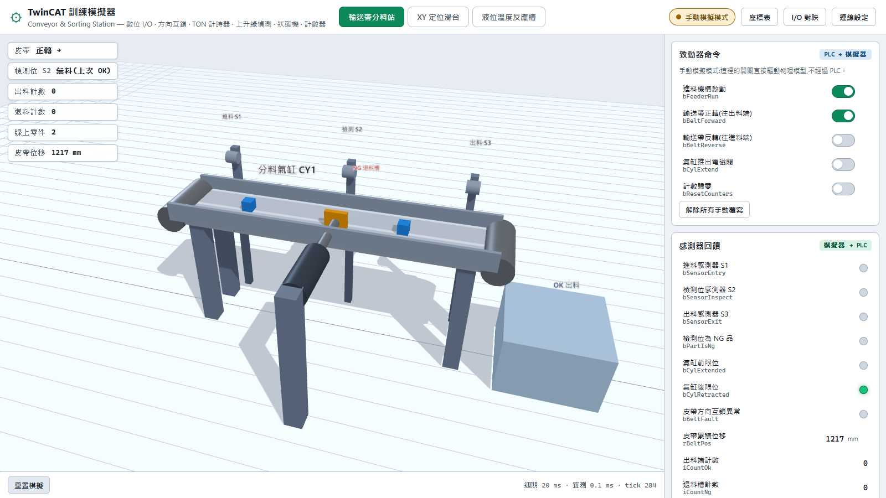
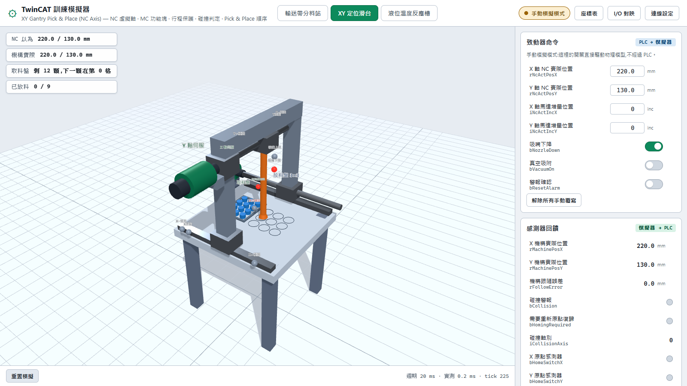
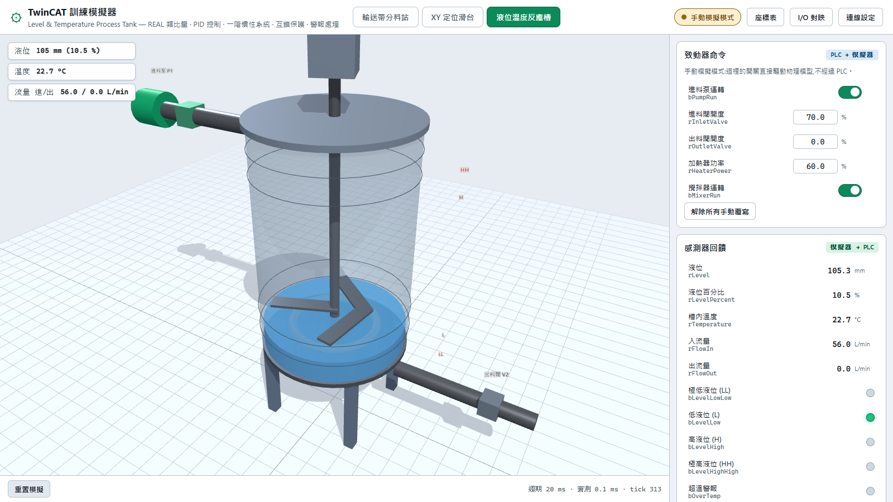

# TwinCAT 訓練模擬器

用網頁模擬真實機台的物理行為,透過 ADS 與 TwinCAT PLC 雙向即時交握,讓學員在沒有實體設備的情況下練習 PLC 程式撰寫與調機。

三個可切換的場景,涵蓋從數位 I/O 到 PID 調變的教學面向:

| 場景 | 教學重點 | GVL |
|------|---------|-----|
| **輸送帶分料站** | 數位 I/O、方向互鎖、TON 計時器、上升緣偵測、狀態機、計數器 | `GVL_Conveyor` |
| **XY 定位滑台** | NC 虛擬軸、MC 功能塊、行程保護、碰撞判定、Pick & Place 順序 | `GVL_Gantry` |
| **液位溫度反應槽** | PID 控制、一階慣性系統、互鎖保護、警報處理 | `GVL_Tank` |

A web-based machine simulator for TwinCAT PLC training: write PLC code, watch a 3D machine respond in real time over ADS.
(以網頁 3D 機台模擬器搭配 TwinCAT PLC,即時練習程式撰寫與調機。)

| 輸送帶分料站 | XY 定位滑台 | 液位溫度反應槽 |
|:---:|:---:|:---:|
|  |  |  |

---

## 運作原理

```
┌──────────────┐   ADS(批次讀寫)   ┌────────────────┐   WebSocket   ┌──────────┐
│ TwinCAT PLC  │ ←──────────────→  │ Node.js 模擬器  │ ←──────────→  │  瀏覽器   │
│  你寫的程式   │                   │  物理模型引擎    │               │ 3D 視覺化 │
└──────────────┘                   └────────────────┘               └──────────┘
     致動器命令 ──────────────────────────→ 物理計算
     感測器回饋 ←──────────────────────────
```

模擬器每 20 ms 做一輪:

1. 用 `readRawMulti` 一次讀回 PLC 所有致動器命令(馬達、閥、電磁閥…)
2. 推進物理模型一個時間步
3. 用 `writeRawMulti` 一次寫回所有感測器訊號(光電開關、位置、液位…)
4. 把視覺化狀態推送給瀏覽器

批次讀寫的意義:一個場景有二十幾個訊號,逐一 `readValue` 會產生二十幾次 ADS 往返;批次壓成一次後,本機實測整輪不到 1 ms。

**瀏覽器不能直接講 ADS**,因為 ADS 走的是原生 TCP。Node.js 後端就是那座橋:對 PLC 講 ADS,對瀏覽器講 WebSocket。

---

## 快速開始

### 1. 安裝

```bash
npm install
```

### 2. 先不接 PLC,確認模擬器本身會動

```bash
npm run mock
```

開啟 <http://localhost:3300>。手動模擬模式下,側欄的致動器開關直接驅動物理模型 —— 打開「進料機構」和「輸送帶馬達」就會看到零件開始跑。**這一步不需要 TwinCAT。**

### 3. 接上 TwinCAT

```bash
npm start
```

預設連本機 `127.0.0.1.1.1:851`。連線狀態顯示在右上角,點「連線設定」可以改 AmsNetId 與埠號。

### 打包發給學生

> 已打包好的版本(含 `node.exe`,免安裝 Node.js)請到 [GitHub Releases](https://github.com/Lance0901/TwinCAT-Training-Simulator/releases) 下載。以下是自行打包的方式。

```bash
npm run package
```

產出兩份:

| | |
|---|---|
| `release\TwinCAT-Simulator-v<版本>\` | 解壓即用的資料夾(約 86 MB) |
| `release\TwinCAT-Simulator-v<版本>.zip` | 發給學生的壓縮檔(約 **33 MB**) |

**裡面含 `node.exe` 與所有執行時期相依,學生電腦不需要先裝 Node.js** —— 只要有 TwinCAT(ADS router 由它提供)就能跑。打包時會自動排除 vite、three 這些只在 build 階段用得到的套件。

學生端有三種用法:

- **免安裝** —— 解壓後點 `啟動模擬器.bat`,瀏覽器自動開啟,關掉視窗就結束
- **要捷徑與正式移除** —— 點 `安裝.bat`,裝到 `%LOCALAPPDATA%\TwinCATSimulator`(**不需系統管理員權限**),建立桌面與開始選單捷徑,並註冊到「設定 › 應用程式」
- **移除** —— 從「設定 › 應用程式」,或執行安裝目錄裡的 `解除安裝.bat`

打包腳本會取用**執行打包那台機器上的 `node.exe`**。

> 改過前端的話 `npm run package` 會自動先跑一次 build,不必手動處理。

### 開發模式(改前端會熱更新)

```bash
npm run dev
```

後端在 3300,Vite 在 5173 並自動把 `/api` 與 `/ws` 轉給後端。**開發時請開 <http://localhost:5173>**。

改完前端要讓 `npm start` 也吃到,執行 `npm run build`。

---

## TwinCAT 端設定

### 建立 PLC 專案

1. TwinCAT XAE 開新專案 → 加一個 Standard PLC Project
2. 在 PLC 專案上按右鍵 → **Add** → **Existing Item**,把 `plc\` 底下這些檔案全部加進來:

   | 檔案 | 說明 |
   |------|------|
   | `GVL_Conveyor.TcGVL` / `GVL_Gantry.TcGVL` / `GVL_Tank.TcGVL` | 三個場景與模擬器的介面變數 |
   | `MAIN.TcPOU` | 主程式,呼叫三個場景的範例邏輯 |
   | `FB_ConveyorDemo.TcPOU` | 輸送帶狀態機範例 |
   | `FB_GantryDemo.TcPOU` | Pick & Place 順序控制範例 |
   | `FB_TankDemo.TcPOU` | 雙迴路 PID 控制範例 |
   | `FB_SimplePID.TcPOU` | 教學用 PID 控制器(無需額外函式庫) |

   GVL 要放在 **GVLs** 資料夾底下,POU 放在 **POUs**。

3. 加入函式庫 **Tc2_MC2**(XY 滑台場景用得到):
   PLC 專案 → References → 右鍵 **Add Library** → 搜尋 `Tc2_MC2`
4. 確認 `MAIN` 掛在 PlcTask 底下,**Task 週期設 10 ms**
   （改週期的話,`MAIN` 裡的 `rCycleTime` 要跟著改,否則 PID 的積分與微分項會失準）
5. **Build** → **Activate Configuration** → 切換到 **Run Mode**
6. Login 並 Start

### 建立 NC 虛擬軸(只有 XY 滑台場景需要)

另外兩個場景不用做這一段。

1. 在 **MOTION** 節點右鍵 → **Add New Item** → 選 **NC/PTP NC-Task 1 SAF**
2. 展開 **NC-Task 1 SAF** → **Axes** → 右鍵 **Add New Item** → 建立 **Axis 1**,
   型別選 **Continuous Axis**。重複一次建立 **Axis 2**
3. 每個軸點進 **Parameter** 頁籤,把 **Simulation Axis** 設為 **TRUE** —— 
   這樣不需要任何實體驅動器,NC 會自己產生位置回授
4. **關鍵一步**:同一個 Parameter 頁籤找到 **Soft Position Limit**
   
   | 想做什麼 | 怎麼設 |
   |---------|-------|
   | 練撞機、看碰撞警報 | 把上下限**關閉**,或設成比機械行程更寬(如 −100 ~ 500) |
   | 練正常生產、不撞機 | 設成 0 ~ 400(X)、0 ~ 300(Y),讓 NC 自己擋下來 |
   
   這兩種設定的差別,正是這個場景要教的東西。
   
5. 回到 PLC 專案,展開 **MAIN** → 選 `AxisX` → 右鍵 **Change Link** → 選 **Axis 1**;
   `AxisY` 連到 **Axis 2**
6. **Activate Configuration**

### 只想自己寫程式、不要範例邏輯

只加三個 `.TcGVL` 就好。GVL 是模擬器唯一在意的東西,PLC 那側怎麼寫都可以。

### 已經有既有專案?不必匯入任何東西

`.TcGVL` 只是「一次到位的建議宣告」,不是硬性要求。**模擬器綁的是符號路徑,不是變數名稱** —— 手上已經有專案的話,開「I/O 對映」把每個訊號接到你現有的變數就好,`MAIN.bMotorFwd` 之類的路徑都可以。

模擬器改版時也一樣:

| 情況 | 要做什麼 |
|------|---------|
| 某個訊號被移除 | 什麼都不用做,PLC 端留著即可,模擬器不再讀它 |
| 某個訊號改名 | 在 I/O 對映指回你原本的變數 |
| 新增了訊號 | PLC 端加一個型別相符的變數再對映;**不綁也能跑**,只是少拿到那項資訊 |

未綁定的訊號不會讓模擬停擺:模擬器→PLC 的方向只是寫不進去,PLC→模擬器的方向則以型別預設值(FALSE / 0)代入。

### 連線設定

| 情境 | AmsNetId | 需要 ADS Route? |
|------|----------|----------------|
| 模擬器與 TwinCAT 同一台 | `127.0.0.1.1.1` | 不需要 |
| TwinCAT 在另一台 IPC/CX | 對方的 AmsNetId | **需要**,兩端都要建立 |

跨機器時,在兩端的 TwinCAT 系統管理員（右下角圖示 → Router → Edit Routes）互相加入對方,並確認防火牆放行 **TCP 48898**。

PLC Runtime 埠號:第一個 runtime 是 **851**,第二個 852,依此類推。

---

## 機台 I/O 表

點右上角的「**I/O 對映**」。面對一台陌生的機台,工程師要先搞懂兩件事,這一頁就是回答這兩件事的:

**輸入訊號 — 這台機器會回報給你什麼**
感測器、位置回饋、警報。模擬器寫入、PLC 只能讀 —— 在 PLC 程式裡對這些變數賦值沒有意義,每個週期都會被覆蓋掉。

**輸出訊號 — 你能控制這台機器什麼**
馬達、閥、電磁閥。PLC 寫入、模擬器讀取,這些才是你的程式實際能下的命令。

每個訊號都列出:

| 欄位 | 說明 |
|------|------|
| 名稱與型別 | 訊號用途與 IEC 資料型別 |
| 觸發條件 | 什麼情況下會 ON、數值範圍與單位、有哪些互鎖 |
| 即時值 | 現在的值,看規格的同時就能對照實際狀態 |
| 接到 PLC 變數 | 這個訊號綁到哪個 PLC 符號 |
| 綁定狀態 | ✓ 已綁定 / ✕ 失敗(滑鼠移上去看原因)/ ○ 未連線 |

### 改接到自己的變數

場景定義裡的 `GVL_Conveyor.bBeltForward` 只是**建議路徑**。手上已經有既存專案、或習慣自己的命名時,直接在「接到 PLC 變數」欄位改成任何路徑即可,例如 `MAIN.bMotorForward`。

連上 TwinCAT 後按「**讀取 PLC 變數清單**」,輸入框就會有下拉選單,而且**只列出型別相符的變數** —— BOOL 訊號不會讓你選到 REAL。PLC 還沒下載程式時清單讀不到,這時手動輸入完整路徑一樣可以。

改過的訊號會標成黃色,按「全部恢復預設」可還原整個場景。

型別大小不符會直接拒絕綁定並顯示原因,不會硬寫下去踩到相鄰記憶體。

#### 綁好的東西存在哪

發佈包根目錄的 `config\` 資料夾,和 `README.txt` 同一層:

| 檔案 | 內容 |
|------|------|
| `io-mapping.json` | 每個場景改接過的 PLC 變數(只存與預設不同的) |
| `session.json` | 上次停在哪個場景 |

對映是**按場景分開存**的,所以重開後也會回到上次的場景 —— 不然在 XY 滑台綁好、重開卻停在輸送帶,看到的是另一份清單,很容易誤以為綁定全不見了。

換新版時直接執行新版的 `安裝.bat`,舊設定會自動接過去,不必重綁。**要換版本就不要先解除安裝** —— 解除安裝會連同 `config\` 一起清掉。

---

## 網頁操作說明

**場景切換** —— 上方三個分頁。切換會重建物理模型並重新綁定 ADS 符號。

**致動器命令(PLC → 模擬器)** —— 正常情況下由 PLC 寫入,面板唯讀顯示。直接點開關可以**暫時覆寫**成手動值,方便單獨測試某個機構;右側的 ● 表示該訊號正被覆寫,點一下交還給 PLC。

**感測器回饋(模擬器 → PLC)** —— 模擬器算出來、寫進 PLC 的值,純顯示。

**物理參數** —— 皮帶速度、氣缸行程時間、槽體截面積…等,可即時調整,用來製造不同難度的情境。

**手動操作** —— 直接對物理模型下指令(投料、補滿取料盤、緊急排空…),不經過 PLC。

**3D 視圖** —— 滑鼠左鍵拖曳旋轉、滾輪縮放、右鍵平移。

---

## 場景細節

### 場景 1:輸送帶分料站

進料機構週期送料 → 皮帶輸送 → 檢測位判別 OK/NG → NG 品由氣缸推入退料槽 → OK 品計數出料。

零件通過感測窗只有零點幾秒(皮帶 200 mm/s、感測窗 ±30 mm ⇒ 0.3 秒),所以範例程式採「停帶再判別」的狀態機。想挑戰的話可以改成邊走邊推的預測式推料。

皮帶是**雙向**的:`bBeltForward` 往出料端、`bBeltReverse` 往進料端。兩個同時給命令會觸發互鎖 —— 皮帶強制停止並把 `bBeltFault` 拉起來。真實機台的電磁接觸器有硬體互鎖會擋掉,但程式本來就不該產生這種命令,所以模擬器直接把它報出來。範例程式的 `bJogReverse` 示範了停止狀態下的寸動反轉退料。

反轉開太久,零件會退出進料端而流失,計入 `iCountReturned`;正常生產時這個數字應該保持 0。

**怎麼看出檢測位判到什麼**:`bPartIsNg` 只在零件停留於感測窗的那零點幾秒有效(60 mm 窗 ÷ 200 mm/s ≈ 0.3 秒),盯著側欄的燈很容易錯過。所以 3D 畫面上 S2 感測器頭會直接變色 —— **亮綠 = 判定 OK、亮紅 = 判定 NG**,左上角 HUD 也會顯示「NG 品 / OK 品」,零件離開後改顯示「無料(上次 NG)」讓你確認判別確實有動作。

**兩個計數器都是位置計數器,不看零件好壞**:

- `iCountOk` = 從出料端離開的總數 —— 分料**沒推成功**的 NG 品也會算進來
- `iCountNg` = 被氣缸推入退料槽的總數 —— 推錯的 OK 品也會算進來

所以手動模式下不開氣缸,紅色零件一樣會流到出料端被計進 `iCountOk`。這不是 bug,分料是 PLC 的職責。拿這兩個數字跟實際投料比對,正好可以驗證分料邏輯寫得對不對。

幾何常數:皮帶長 1000 mm,進料感測器 @120 mm,檢測位 @520 mm,出料感測器 @900 mm。

### 場景 2:XY 定位滑台(NC 虛擬軸)

**運動控制完全由 TwinCAT NC 負責,模擬器只扮演機械本體。**

關鍵在於:**機構跟隨的是「增量」,不是 NC 換算後的 mm。**

```
NC 依自己的 Scaling Factor 把 mm 換成脈衝 → PLC 抄進 GVL
                                              ↓
              模擬器依「它自己的」機械規格把脈衝換回距離
                                              ↓
      兩邊規格對不上 → 機構走錯距離 → 走出行程 → 撞上擋塊
```

模擬器不會去比對 NC 設了什麼,也不需要 —— 真實的驅動器收到幾個脈衝就走多遠,不會過問控制器怎麼算的。

PLC 端要做的:

```pascal
rNcScaling := rNcPitch / (rNcEncInc * rNcGear);   // 照抄你在 NC 設的三個值
GVL_Gantry.iNcActIncX := LREAL_TO_DINT(AxisX.NcToPlc.ActPos / rNcScaling);
```

> **這個增量沒有現成的 NC 變數可以對映,PLC 必須自己反算。**
>
> 查過 Beckhoff 文件後確認,以下三處都不提供原始編碼器計數:
>
> | 來源 | 結果 |
> |------|------|
> | `NCTOPLC_AXIS_REF`(40 幾個成員) | 全是使用者單位,`ActPos`、`SetPos`、`ActPosWithoutPosCorrection` 都是 mm |
> | `MC_AxisParameter` 列舉 | 有一整組 Encoder 參數,但沒有 raw counter |
> | NC 軸參數表(IndexGroup `0x4000+ID`) | 同上 |
>
> 原始計數屬於 Encoder 的 **State**(`0x5100+ID`)或 **Cyclic process data**(`0x5300+ID`)物件,Beckhoff 沒有公開這兩張 offset 表;而且**虛擬軸根本沒有實體驅動器的 PDO**。實體軸的話反倒簡單 —— raw count 就在驅動器的過程資料裡(EL7041 的 Counter value、AX5000 的 Position actual value),直接 I/O 連結即可。
>
> 所以虛擬軸只能反算。但這不是妥協:除數是用 `MC_ReadParameter` 向 NC 問來的,**和 NC 內部換算用的是同一個值**,結果與真正的增量在數學上完全一致。

PLC 端的做法:

```pascal
// 向 NC 問出它實際使用的縮放係數(mm/increment)
fbReadScaleX(Axis := AxisX, Enable := TRUE,
             ParameterNumber := MC_AxisParameter.AxisEncoderScalingFactor);

IF fbReadScaleX.Valid AND (fbReadScaleX.Value > 0) THEN
    rNcScalingX := fbReadScaleX.Value;
END_IF

GVL_Gantry.iNcActIncX := LREAL_TO_DINT(AxisX.NcToPlc.ActPos / rNcScalingX);
```

`AxisEncoderScalingFactor` 對應 NC 參數 `0x00n10006`「Resulting scaling factor (numerator / denominator)」,單位就是 mm/INC。TC3 另有 `AxisEncoderScalingNumerator`(`0x00n10023`)與 `AxisEncoderScalingDenominator`(`0x00n10024`)可分別讀分子分母。

這樣就沒有「手填的值和 NC 設定不一致」的問題 —— 真正比對的是 **NC 設定 ↔ 機械規格**。

#### 為什麼要傳增量,不直接傳 mm?

**因為只傳 mm 的話,scaling 設錯這件事根本演練不出來。** 模擬器收到「100 mm」就把機構搬到 100 mm,NC 的 Scaling Factor 設成什麼都不影響結果。

改傳增量之後,換算的責任回到機械這一側,兩邊規格不一致距離自然對不上 —— 而模擬器全程不需要知道 NC 設了什麼,就像真實驅動器不會過問控制器怎麼算的。

要坦白的是:**這在真實專案裡不存在。** PLC 從 `NcToPlc.ActPos` 拿到的本來就是 mm,沒有人會去反算增量;那段除法是為了這個演練而加的。

**不做 scaling 演練就不用接這兩個訊號** —— 填 0 或不綁定時,模擬器會退回用 `rNcActPosX` 直接當 mm,行為跟一般的 NC 模擬完全一樣。

#### 機械規格

網頁的「物理參數」裡直接輸入,代表這台機器的實體規格:

| 參數 | 預設 |
|------|------|
| 馬達編碼器解析度 | 10000 inc/rev |
| 螺桿導程 | 10 mm/rev |
| 減速比(馬達:螺桿) | 2 |

這三個是**數值輸入框**不是滑桿 —— 這裡要填的就是規格書上那個數字,像伺服編碼器的 `1048576`(2²⁰)拖滑桿根本對不準。

換算出來的機械縮放 = `10 ÷ (10000 × 2)` = **0.0005 mm/inc**,HUD 上會即時顯示。你在 NC 的 Scaling Factor 必須算出同一個值。

#### 撞機演練

**演練一:scaling 設錯**

模擬器設一圈 1000 pulse,NC 卻設成 10000。NC 為了走 100 mm 會送出 200000 個增量,而機構每個增量走 0.005 mm ——

| | 值 |
|---|---|
| NC 以為 | 100 mm |
| 送出增量 | 200000 inc |
| 機構實際 | **撞死在 400 mm 的擋塊上** |
| 跟隨誤差 | 600 mm |

一個動作就撞了。這種錯誤在 PLC 程式裡完全看不出來 —— 邏輯、順序、功能塊全都對。

**演練二:軟體極限沒設好**

NC 的 Soft Position Limit 關掉或設得比機械行程寬,`MC_MoveAbsolute` 到 450 mm 就會直接撞。而 NC 自己完全不會發現,因為虛擬軸沒有真實負載。

兩種演練的現象一樣:

| 訊號 | 現象 |
|------|------|
| `rMachinePosX/Y` | 停在擋塊上不再跟隨 |
| `rFollowError` | NC 位置與機構位置的差值持續累積 |
| `bCollision` | 閂鎖警報 |
| `bHomingRequired` | 一併亮起,而且**按警報確認也不會消失** |

3D 畫面上整座龍門會閃紅,並用**紅色十字標出「NC 以為自己在哪」** —— 那個十字跟機構的距離就是跟隨誤差。

想立刻試:切到手動模擬模式,把「馬達編碼器解析度」調到 1000,再把 `iNcActIncX` 打成 `200000`。

#### 撞完之後:按確認不夠,要開回原點

撞機後機構與 NC 的座標已經對不上,所以警報處理分成兩段 —— 跟真實機台一樣。

| 動作 | `bCollision` | `bHomingRequired` | 能不能吸料 |
|------|-------------|-------------------|-----------|
| 撞上擋塊 | TRUE | TRUE | 不行 |
| 按 `bResetAlarm` 確認 | FALSE | **仍為 TRUE** | 不行 |
| 開離擋塊到行程內 | FALSE | **仍為 TRUE** | 不行 |
| **開回原點感測器**(X、Y 都 ≤ 8 mm) | FALSE | FALSE | 可以 |

`bResetAlarm` 只是「承認這件事發生了」,等於關掉蜂鳴器。**只有機構實際回到原點,`bHomingRequired` 才會自動解除**;在那之前真空吸附一律不成立,因為位置不可信 —— 吸了也是吸錯地方。

龍門的顏色會告訴你在哪個階段:

- **閃紅** = 正在撞
- **恆亮琥珀** = 警報已確認,但還沒復歸
- **原色** = 正常

範例程式的錯誤狀態(步序 900)確認後不會跳回待機,而是跳回**步序 5 重新致能並走一次完整的原點復歸**。要是復歸沒真的把機構開回感測器範圍,步序 30 會再把它擋下來。

趕時間或純測 3D 的話,網頁上有「強制標記已復歸(維修用)」可以跳過,但正常流程請實際開回原點。

#### 為什麼沒有「軸致能」和「實際速度」訊號

因為 NC 模式下用不到。`MC_Power` 沒致能,NC 就不會產生新位置,增量不變、機構自然停著,不需要再告訴模擬器一次。速度也一樣 —— 模擬器從增量的變化自己就算得出來。

I/O 表上只留真正有作用的訊號。

#### 感測器怎麼看

3D 畫面上每個感測器都有指示燈,**亮紅 = 有感測到、灰 = 沒感測到**,位置就是它在機構上的實際安裝點:

| 感測器 | 裝在哪 |
|--------|--------|
| `bLimitXNeg` / `bHomeSwitchX` / `bLimitXPos` | 從動側導軌外緣,對應 X = 0 / 40 / 400 mm |
| `bLimitYNeg` / `bHomeSwitchY` / `bLimitYPos` | 橫樑上,跟著門架移動 |
| `bNozzleIsUp` / `bNozzleIsDown` | 滑座側面 |
| `bPartHeld` | 吸嘴頭旁,跟著升降 |
| `bPartAtPick` | 取料盤旁 |

**硬體極限只回報,不會自己停。** 燈亮了機構照樣跟著 NC 走 —— 要不要停是 PLC 程式的責任,這正是要讓學生自己寫的保護邏輯。不理它繼續往前,再 5 mm 就撞上機械擋塊並觸發 `bCollision`。

#### 格位座標

行程 X 0–400 mm、Y 0–300 mm。網頁上按「**座標表**」可以查全部座標,並一鍵複製成 ST 陣列宣告貼進 PLC 專案。

**取料盤 3×4 = 12 格**(格距 42 mm)。這是**一格一格取**的:第 0 格取完才換第 1 格,停到別格是吸不到料的。該去哪一格不用自己數 —— `iNextPickIndex` 會直接告訴你。

| 格號 | 0 | 1 | 2 | 3 | 4 | 5 | 6 | 7 | 8 | 9 | 10 | 11 |
|------|---|---|---|---|---|---|---|---|---|---|----|----|
| X | 40 | 82 | 124 | 40 | 82 | 124 | 40 | 82 | 124 | 40 | 82 | 124 |
| Y | 40 | 40 | 40 | 82 | 82 | 82 | 124 | 124 | 124 | 166 | 166 | 166 |

**放料盤 3×3 = 9 格**(格距 60 mm):

| 格號 | 0 | 1 | 2 | 3 | 4 | 5 | 6 | 7 | 8 |
|------|---|---|---|---|---|---|---|---|---|
| X | 200 | 260 | 320 | 200 | 260 | 320 | 200 | 260 | 320 |
| Y | 60 | 60 | 60 | 120 | 120 | 120 | 180 | 180 | 180 |

兩個盤共用同一套編號規則:

```
X = x0 + (i MOD cols) × dx
Y = y0 + (i /   cols) × dy
```

直接拿去用的話:

```pascal
aPickPosX  : ARRAY[0..11] OF REAL := [40, 82, 124, 40, 82, 124, 40, 82, 124, 40, 82, 124];
aPickPosY  : ARRAY[0..11] OF REAL := [40, 40, 40, 82, 82, 82, 124, 124, 124, 166, 166, 166];
aPlacePosX : ARRAY[0..8]  OF REAL := [200, 260, 320, 200, 260, 320, 200, 260, 320];
aPlacePosY : ARRAY[0..8]  OF REAL := [60, 60, 60, 120, 120, 120, 180, 180, 180];
```

#### 其他

原點復歸刻意用「點動找感測器 + `MC_SetPosition`」而不是 `MC_Home`:虛擬軸沒有實體原點編碼器,但模擬器提供了 `bHomeSwitchX/Y`,走一次真實的尋原點流程,學員才知道原點是怎麼建立的。

**放料成敗的判定很嚴格**:真空必須在吸嘴下降到位時才放開,而且位置要落在格位中心 6 mm 內。順序寫錯就會掉件,畫面上會留下紅色的倒地工件。

### 場景 3:液位溫度反應槽

- **液位**:`dV/dt = Qin − Qout`,出料採托里切利定律(流速正比於液位平方根)
- **溫度**:加熱功率、進料冷水混合、環境散熱三者的能量平衡

預設是實驗室規模(滿槽約 80 L),滿功率升溫約 0.18 K/s,一次 PID 調機實驗 2–3 分鐘看得到完整響應。想觀察大慣性系統就把截面積調大、加熱功率調小。

刻意留給學員踩的坑:

- `rInletValve` 開再大,`bPumpRun` 是 FALSE 就沒有流量
- 液位太低還在加熱會觸發乾燒警報,而且空槽的熱容小、溫度衝很快
- 攪拌器停止時加熱效率下降(局部過熱),散熱也變差

---

## 常見問題

**右上角顯示「N 個符號未綁定」**
開「I/O 對映」看哪幾個訊號是 ✕,滑鼠移到圖示上會顯示原因。常見情況:`.TcGVL` 還沒加入專案、還沒 Build、還沒下載到 Runtime,或變數名稱與場景定義不同(這時直接在該欄位改成你實際的變數路徑)。模擬器仍會繼續跑,只是那幾個訊號不會與 PLC 交換。

**按「讀取 PLC 變數清單」顯示「PLC Runtime 尚未下載任何程式」**
ADS 連上了,但 851 埠底下沒有任何 PLC 專案。先在 TwinCAT 下載並 Run,清單才讀得到。在那之前對映欄位仍可手動輸入。

**不知道 AmsNetId 要填什麼**
「連線設定」裡按「**搜尋可用的 TwinCAT**」,會列出本機與所有已建立 Route 的目標,點一下就填進欄位。每一列右邊直接顯示狀態:

```
127.0.0.1.1.1        本機(loopback) · localhost      Config 模式
<your-plc-ams-netid>  本機 · localhost               Config 模式
<remote-ams-netid>    <remote-host> · <remote-ip>    無回應
```

它問的是本機 AMS Router 的路由表,不是廣播掃描 —— TwinCAT 的「Add Route」對話框是用 UDP 48899 廣播找設備,但那個埠被 `TCATSysSrv` 獨佔,第三方程式綁不上去(會拿到 `EACCES`)。而且就算廣播找得到,沒有雙向 Route 一樣連不上,列出來只會誤導。**要新增沒列在裡面的機器,還是得用 TwinCAT 的 Add Route 對話框建立 Route**,建好之後就會出現在這個清單裡。

「無回應」代表 Route 有設定但對方沒回 —— 關機、不在同網段,或對方沒有回指本機的 Route。

**連 `127.0.0.1.1.1` 顯示連上了,但什麼都讀不到**
右上角徽章會直接寫出卡在哪一段,先看它:

| 徽章 | 意思 | 怎麼辦 |
|------|------|--------|
| `TwinCAT 在 Config 模式,需切到 Run Mode` | 連得到 AMS Router,但整個 TwinCAT 系統在組態模式,底下根本沒有 runtime | TwinCAT 工具列按 **Restart TwinCAT (Run Mode)** |
| `ADS 已連線,但 PLC 沒有程式` | 系統在 Run,但 851 埠沒有下載過專案 | 下載 PLC 專案並 Start |
| `PLC Runtime 在 Stop,不是 Run` | 程式在但沒跑 | 按 Start |

三種都會顯示「已連線」,因為 AMS 這一層確實通了 —— 連得上 Router 和有 PLC 可讀寫是兩件事。狀態變成 Run 之後模擬器會自動重新綁定,不必手動重連。

`127.0.0.1.1.1` 是 AMS 的 loopback,指向本機 Router,和你本機實際的 AmsNetId(通常是 IP + `.1.1`)是同一台。兩個填哪個都可以。

**啟動時顯示「沒有連上 TwinCAT,先以手動模擬模式執行」**
TwinCAT 沒開、Runtime 沒啟動,或 AmsNetId 不對。模擬器不會因此停擺,網頁一秒內就能操作 —— ADS 連線是在背景進行的,不會擋住畫面。排除問題後在網頁上點「連線設定」→「連線」即可,不必重啟。

**PLC 重新下載程式後訊號就不動了**
不會發生。模擬器監聽 `plcSymbolVersionChange`,程式重新下載後會自動重新解析符號位址。

**感測器訊號會漏檢**
把皮帶速度調慢,或降低 `SIM_CYCLE`(環境變數,預設 20 ms)。零件通過感測窗的時間必須明顯大於模擬週期。

**PID 響應跟預期差很多**
確認 `MAIN` 裡的 `rCycleTime` 與實際 PlcTask 週期一致。這個值錯了,積分時間與微分時間的物理意義就整個跑掉。

**XY 滑台的機構不會動**
機構跟隨的是 `rNcActPosX/Y`,而那是 PLC 從 `AxisX.NcToPlc.ActPos` 抄過去的。依序檢查:NC 軸建好了嗎、`MAIN` 裡的 `AXIS_REF` 連結到軸了嗎、`MC_Power` 的 `Status` 起來了嗎。在網頁的 I/O 對映頁面看 `rNcActPosX` 有沒有在變,一眼就知道斷在哪一段。

**一啟動就報碰撞**
NC 的位置和機構的座標系沒對齊 —— 通常是還沒做原點復歸,NC 的 ActPos 停在某個負值或超出 400 的位置。先跑一次尋原點,或用 `MC_SetPosition` 把當前位置定義為 0。

**想撞卻撞不了**
NC 的 Soft Position Limit 已經把命令擋在行程內了,機構根本到不了擋塊。把軟體極限關掉或放寬(見上面的 NC 軸建立步驟)。

---

## 環境變數

| 變數 | 預設 | 說明 |
|------|------|------|
| `SIM_PORT` | `3300` | HTTP / WebSocket 埠號 |
| `SIM_MODE` | `ads` | `ads` 或 `mock` |
| `SIM_CYCLE` | `20` | 模擬週期 (ms) |
| `SIM_PUSH` | `33` | 網頁狀態推送週期 (ms) |
| `SIM_SCENARIO` | (空) | 固定啟動場景。不設就沿用上次停在哪個場景,沒有紀錄時用 `conveyor` |
| `SIM_CONFIG` | `config/` | 設定檔存放目錄。發佈包的啟動腳本會把它指到根目錄的 `config\` |
| `ADS_NETID` | `127.0.0.1.1.1` | 目標 AmsNetId |
| `ADS_PORT` | `851` | PLC Runtime 埠號 |
| `ADS_ROUTER` | (空) | 遠端 Router IP,本機不需要 |

---

## 專案結構

```
shared/scenarios/     場景定義(I/O 清單、觸發條件、參數、幾何)—— 前後端與 PLC 三方共用的契約
server/
  index.js            Express + WebSocket
  engine.js           模擬迴圈
  ads-bridge.js       ADS 連線與符號綁定
  ads-scan.js         列出本機 Router 認得的目標(系統服務 IndexGroup 0x323)
  ads-codec.js        IEC 型別 ↔ Buffer 編解碼
  mapping.js          I/O 對映的讀寫(config/io-mapping.json)
  session.js          上次停在哪個場景(config/session.json)
  paths.js            設定目錄位置,發佈包用 SIM_CONFIG 改指到根目錄
  scenarios/          三個場景的物理模型
web/
  main.js             WebSocket 用戶端與狀態分發
  ui.js               側欄面板與機台 I/O 表(build / update 兩階段,避免每幀重繪)
  scenes/             Three.js 3D 場景
plc/                  TwinCAT GVL 與範例 POU(可直接 Add Existing Item)
config/               I/O 對映設定,執行中自動產生
```

## 新增一個場景

1. `shared/scenarios/你的場景.js` —— 定義 `outputs` / `inputs` / `params` / `geometry`,並在 `index.js` 註冊
   每個訊號記得寫 `desc`(觸發條件與範圍),那是機台 I/O 表最有價值的欄位
2. `server/scenarios/你的場景.js` —— 匯出 `createModel()`,回傳 `{ reset, step, command }`;`step(dt, outputs, params)` 回傳 `{ inputs, view }`
3. `web/scenes/你的場景.js` —— 繼承 `Scene3D`,實作 `build()` 與 `update(state)`,在 `scenes/index.js` 註冊
4. `plc/GVL_你的場景.TcGVL` —— 變數名稱要與場景定義的 `tag` 完全一致

前端場景清單由後端在 WebSocket 的 `hello` 訊息帶過來,新增後不必改 UI 程式碼。

---

## 除錯

瀏覽器 console 有 `__sim` 可用:

```js
__sim.state.engine.view           // 目前的物理狀態
__sim.send({ t: 'setOverride', key: 'beltRun', value: true })
__sim.sceneHost.current.renderer.info   // 3D 渲染統計
```

後端狀態也可以直接查:

```bash
curl http://localhost:3300/api/state
```

---

## 授權

[MIT](LICENSE) © 2026 Lance Pan
